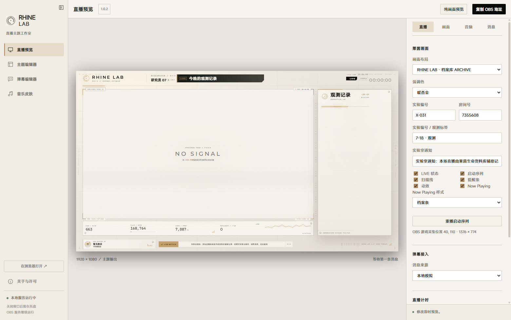

# RHINE LAB · 直播主题

> 基于 [CONTROL-Resonant-Bilibili-Livestream-Theme](https://github.com/Huajijiangqwq/CONTROL-Resonant-Bilibili-Livestream-Theme) 二次修改的《明日方舟》莱茵生命「内部资料档案」风格 OBS 直播主题与本地主题工作室。

**1.0.1 · Windows x64 · OBS 浏览器源 · MIT / CC BY 4.0**

[上游项目](https://github.com/Huajijiangqwq/CONTROL-Resonant-Bilibili-Livestream-Theme) · [原项目演示视频](https://www.bilibili.com/video/BV1DvaP62Ekf/) · [启动说明](启动说明.txt) · [更新记录](CHANGELOG.md) · [宣传片说明](promo/README.md)



---

## 宣传片

**RHINE LAB · 直播主题 1.0.1** 配套宣传片：`RHINE-LAB-PROMO-1080p60.mp4`（70.4 秒 / 1920×1080 / 60 fps / H.264 CRF 22 / AAC 48 kHz 立体声 / −14 LUFS）。

- 剪辑锁在 **「Rhine Lab.LLC」112.5 BPM** 的小节线上，每 2.133 秒一个切点。
- 画面中的直播画面、主题编辑器、三种基础画面全部来自**本软件真实运行的界面**（本地服务 + 真实消息接口），叠加 3D 舞台与标注。
- 工程与复现方式见 [promo/README.md](promo/README.md)。

## 与上游项目的关系

- 上游项目：**CONTROL-Resonant-Bilibili-Livestream-Theme**，作者 Huaji264 / Huajijiangqwq，MIT 与 CC BY 4.0。
- 原项目演示视频：[BV1DvaP62Ekf](https://www.bilibili.com/video/BV1DvaP62Ekf/)。
- 本项目保留上游的四个工作区、B 站弹幕接入、主题编辑器、弹幕编辑器、音乐皮肤、OBS 浏览器源工作流与本地服务架构。
- 本版把 Control: Resonance 的视觉体系整体替换为莱茵生命「内部资料档案」：暖白纸面、黑白双环徽记、暖杏金强调色（`#C5A16B`）、实验编号与观测记录排版。
- 本项目为非官方粉丝作品，与鹰角网络、Remedy Entertainment、Bilibili、OBS Project 均无关联。

## 本次新增与修改

### 画面与布局

- 直播预览、OBS 输出与主题编辑器画布共用同一套莱茵画面（`app/rhine/scene.html`），不再出现「编辑器一套、OBS 另一套」。
- 莱茵画面拆分为 **24 个独立部件图层**：顶栏、品牌、研究员、标题、LIVE、计时、游戏开孔、观测面板、观测头、消息列表、观测页脚、遥测、粉丝数、播放数、获赞数、人气值、数据波形、档案简报、简报文案、简报数据、简报装饰、Now Playing、通知条、底栏。
- 项目库重建为三套基础画面：**RHINE LAB · 档案库 ARCHIVE**、**全景 PANORAMA**、**研讨台 SEMINAR**，各自带完整的 24 个部件坐标与 OBS 采集位置。
- 首次启动自动预置这三套基础画面与默认直播主题（数据目录为空时），新用户解压即用，无需手动导入。
- 切换画面布局时按预设坐标应用全部 24 个部件；首次打开也会立即下发，不再出现子部件堆在左上角。
- 数据类部件改名为对应数据：**粉丝数 / 播放数 / 获赞数 / 人气值 / 粉丝数 · 人气值**。
- B 站账号数据每 30 分钟同步一次：**FANS / PLAYS / LIKES / POPULARITY**；档案简报同步显示粉丝数与人气值。
- 观测面板的 `LOG.03 / SECURED` 移到标题同一行右侧，标题宽度受控，长标题不会遮挡；`OBSERVATION LOG` 与标题保持间距。
- 去掉消息列表顶部的渐变遮罩与横向亮线，消息区域干净显示。
- 直播计时每次启动静默归零；取消应用内的「开始直播」检测。
- 窗口标题改为「RHINE LAB · 直播主题」。

### 主题编辑器

- 画布就是莱茵画面；24 个部件层可单独选中、拖动、缩放、隐藏，隐藏图层会隐藏对应区块，游戏开孔跟随「游戏画面」层。
- 图层右键菜单新增 **重命名**：自动选中该层并聚焦右侧「图层名称」，预填当前名称，可直接改写。
- 文字部件（品牌、研究员、标题、观测标题、简报文案）支持直接改文字；数据部件禁止文字编辑，避免把数字覆盖成固定文本。
- 文字绑定只应用内容与颜色，不把图层字号/字重套到场景，避免撑破排版。
- 部件级「质感」：阴影、亮度、面板透明度、圆角、颗粒叠层都可单独调整；外观效果区域与部件实际范围同步。
- 界面里的浅色提示、状态栏、缩放标签与「动画预览 / 收起动画预览」文字改为黑色，纸面背景上可读。
- 项目库只保留三套莱茵基础画面，旧的 COD / rhine-lab 预设不再混入。

### 消息

- 直播预览右侧「消息」面板与主题编辑器动画预览使用同一套数据：**普通弹幕 / SC / 礼物档案 / 上舰提示**。
- 新增 **中文预设** 下拉（8 条：档案原文 · 观测记录 / 日常弹幕 · 莱茵生命），选中即填入内容。
- 「发送预览」只生成一条消息并写入莱茵场景，不再重复弹出或铺一长串示例。
- 直播预览不再自动铺种子示例消息；示例只保留在主题编辑器画布。
- 默认数据为莱茵版本：用户名「研究员 07」、内容「欢迎来到莱茵生命资料库」。

### 音乐皮肤

- 音乐皮肤改为莱茵档案卡：暖白纸面、黑白双环徽记、暖杏金频谱。
- 读取真实曲目、封面与播放进度；支持 **Windows SMTC** 与 **NetEase** 两种来源，NetEase 补齐时长、进度与封面。
- Now Playing 支持 **条形 / 卡片** 两种样式，卡片尺寸缩小，避免遮挡其它部件；样式与主题编辑器双向同步。
- 修复音乐画布的质感与流纹显示。

### 隐私

- B 站登录信息在当前系统账户下加密保存；「清除登录信息」会删除加密登录文件、断开内存中的登录会话。
- 日志与浏览器 Cookie 不包含 SESSDATA；账号统计接口只读取公开数据，与登录凭据分离。

## 四个工作区

| 工作区 | 主要用途 |
| --- | --- |
| **直播预览** | 选择画面布局、连接直播间、设置主播信息与计时，复制 OBS 地址。 |
| **主题编辑器** | 以莱茵画面为画布，编辑 24 个部件层、文字、质感、配色，保存项目并应用到直播。 |
| **弹幕编辑器** | 保留上游的消息模板与弹幕区编辑能力。 |
| **音乐皮肤** | 莱茵档案卡样式，显示曲目、封面与进度，支持 SMTC / NetEase 来源。 |

## 三套基础画面

| 项目 | 画面 | 游戏采集位置 |
| --- | --- | --- |
| RHINE LAB · 档案库 ARCHIVE | 16:9 游戏画面 + 右侧观测栏 + 底部遥测 | `40, 110` · `1376 × 774` |
| RHINE LAB · 全景 PANORAMA | 全屏游戏 + 右下浮层观测 | `0, 0` · `1920 × 1080` |
| RHINE LAB · 研讨台 SEMINAR | 游戏 + 大观测栏 + 档案简报 | `40, 126` · `1152 × 648` |

## 下载与安装（Windows x64）

1. 在本仓库 **Releases** 页面下载 `RHINE-LAB-Live-1.0.0-win-x64.zip`。
2. 完整解压后双击 `RhineLab.exe`；不需要安装 Node.js，不要把 exe 单独移出文件夹。
3. 关闭窗口后程序驻留系统托盘，本地服务继续为 OBS 提供页面；托盘右键可退出。
4. 个人设置、登录信息、项目与已应用主题保存在 `%APPDATA%\Control Resonant`，升级时无需复制到程序目录。

## 接入 OBS

1. 在「直播预览 → 画面」选择三套基础画面之一。
2. 点「复制 OBS 地址」，在 OBS 添加 **浏览器** 来源，尺寸设为 **1920 × 1080**。
3. 把自己的 **游戏采集** 放在浏览器源下方，从莱茵画面中间的透明开孔透出。
4. 游戏采集位置随布局变化：
   - 档案库 ARCHIVE：`40, 110` · `1376 × 774`
   - 全景 PANORAMA：`0, 0` · `1920 × 1080`
   - 研讨台 SEMINAR：`40, 126` · `1152 × 648`
5. 主播名、标题、计时、B 站弹幕与本地消息都会实时同步，不需要刷新浏览器源。

## 直播与消息

- 消息来源支持 **本地模拟** 与 **Bilibili 直播间**；B 站可扫码登录，填写房间号或链接后连接。
- 右侧「消息」面板可发送四类测试消息，用于检查排版与入退场效果；测试不会向 B 站直播间发言。
- 账号数据（粉丝 / 播放 / 点赞 / 人气）每 30 分钟刷新，显示在遥测条与档案简报。
- 直播计时支持继续、暂停、归零与设置已播时长；每次启动自动归零。

## 主题编辑器

- 三套基础画面打开后，左侧图层列表列出全部 24 个「部件 · …」层。
- 选中任一部件即可在画布上拖动、缩放或隐藏；右侧属性面板可改位置、尺寸、名称、文字与质感。
- 右键图层可 **重命名**、复制、编组、锁定、调整层级、删除。
- 文字类部件可直接改内容；数据类部件的数字由 B 站数据驱动，不提供文字编辑。
- 编辑器里的浅色提示与动画预览文字已统一为黑色。

## 音乐皮肤

- 播放器通过 **Windows SMTC** 上报曲目时，无需额外服务即可显示歌名、歌手、封面与进度。
- 未上报信息的播放器可切换 **NetEase** 来源。
- Now Playing 支持条形与卡片两种样式；卡片已缩小，位置随画面布局调整。
- 音频捕获与歌曲识别是两套设置：有歌名不代表频谱已开启，首次使用需手动开启音频捕获。

## 数据与隐私

- 数据目录：`%APPDATA%\Control Resonant`（设置、项目、已应用主题、登录凭据）。
- B 站登录信息按当前系统账户加密保存，文件为 `data/bilibili-session-credentials.enc`。
- 「清除登录信息」会删除该文件并断开内存中的登录会话；日志与浏览器 Cookie 不记录 SESSDATA。
- 账号统计接口只读取粉丝 / 播放 / 点赞 / 人气等公开数据，不使用登录凭据，也不属于隐私数据。

## 项目结构

仓库（源码）：

```text
app/                 页面、编辑器、rhine 场景与本地服务
│  ├─ rhine/          莱茵直播画面（scene.html / css / js）
│  └─ rhine-presets/  三套基础画面预设
desktop/             桌面外壳、托盘与本地服务管理
licenses/            第三方许可
package.json
README.md
CHANGELOG.md
screenshot.png
启动说明.txt
```

Releases 中的 `RHINE-LAB-Live-1.0.0-win-x64.zip` 解压后是运行目录：`RhineLab.exe` + `resources/app/`（上述源码与素材）。

## 源码与构建

- 运行发布版不需要 Node.js；源码结构与上游项目一致，页面与编辑器均为原生 JavaScript / Canvas / WebGL。
- 如需自行构建 Windows x64 客户端，请参考上游项目的 `desktop/`、`app/` 源码与 Electron 打包流程；本发布包只提供 Windows x64 运行版。
- 本地服务端口沿用上游规则，默认从 8791 起，登录 / 音频 / 音乐分别使用 +2 / +3 / +4。

## 许可与致谢

- **原创代码**：MIT；**文档与明确列出的自绘素材**：CC BY 4.0。
- 上游项目及其作者：**CONTROL-Resonant-Bilibili-Livestream-Theme / Huaji264（Huajijiangqwq）**；第三方代码、字体与素材按各自许可保留声明，详见 `THIRD_PARTY_NOTICES.md` 与 `licenses/`。
- 字体 Montserrat / Inter / JetBrains Mono 为 SIL OFL 1.1。
- 本项目为非官方粉丝作品；游戏商标、官方美术与用户导入素材的权利归原权利人所有。

## 更新记录

本版从上游 1.0.2 的莱茵画面修改起步，主要变更见 [CHANGELOG.md](CHANGELOG.md)。
